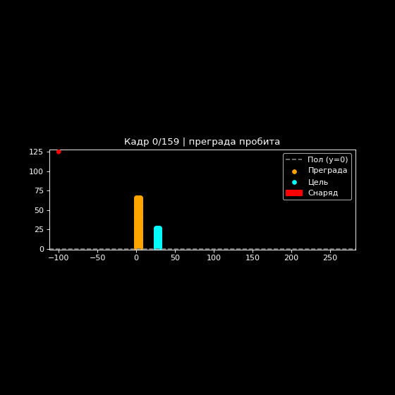

Модель разрушения тел 

Компьютерная модель, реализованная на Python с использованием библиотек NumPy, SciPy и Matplotlib. Программа демонстрирует метод динамики частиц (particle dynamics) на примере задачи разрушения тел: монолитный снаряд пробивает преграду из частиц, а образовавшиеся «осколки» могут поразить расположенную за ней цель. Модель позволяет исследовать процессы пробития, распространения осколков и критерии поражения цели.
1. Краткое описание модели

Модель разрушения тел — это численная модель, в которой среда представляется ансамблем дискретных материальных точек (частиц). Движение каждой частицы описывается классической механикой (второй закон Ньютона), а взаимодействия — парным потенциалом Леннарда-Джонса, силой со стороны пола и силой со стороны снаряда. В отличие от клеточных автоматов, здесь нет дискретной решётки состояний: эволюция системы — результат интегрирования уравнений движения для каждой частицы.
Объекты системы

В двумерной расчётной области рассматриваются три объекта:

    Снаряд — монолитное тело (не деформируется, не распадается), моделируется как материальная точка с массой, радиусом и скоростью;

    Преграда — плоская пластина из частиц, расположенных вертикально и взаимодействующих по потенциалу Леннарда-Джонса;

    Цель — аналогичная плоская пластина меньшего размера, находящаяся за преградой (имитация сценария «цель укрылась за преградой»).

Состояния системы

Каждая частица характеризуется:

    координатой r_i = (x_i, y_i);

    скоростью v_i = (v_x, v_y);

    массой m_i (своя для преграды и цели);

    принадлежностью к группе: is_barrier или is_body.

Снаряд характеризуется положением, скоростью, массой и радиусом. Система эволюционирует непрерывно во времени; «состояния» в смысле клеточного автомата отсутствуют.
Правила перехода

На каждом такте интегрирования (метод Leap-frog) состояние всех частиц обновляется синхронно:

    Полушаг по скорости. v_i^{n+1/2} = v_i^n + (1/2)·F_i^n/m_i·dt.

    Полный шаг по координате. r_i^{n+1} = r_i^n + v_i^{n+1/2}·dt.

    Пересчёт сил F_i^{n+1} (парные LJ, пол, снаряд).

    Второй полушаг по скорости. v_i^{n+1} = v_i^{n+1/2} + (1/2)·F_i^{n+1}/m_i·dt.

Снаряд интегрируется той же схемой с учётом силы со стороны частиц преграды и цели.
Математическая модель

Закон движения для каждой i-й частицы:
text

m_i · d²r_i/dt² = F_i

где равнодействующая сила F_i состоит из:

    силы Леннарда-Джонса F_ij (парное взаимодействие со всеми частицами в радиусе R_CUT);

    силы со стороны пола F_i^floor;

    силы со стороны снаряда F_i^proj.

Парные силы Леннарда-Джонса (между i-й и j-й частицами):
text

F_ij = 24·ε·[2·(σ/r_ij)^12 − (σ/r_ij)^6] · r_ij / r_ij²

где ε — глубина потенциальной ямы, σ — характерный диаметр частицы, r_ij — расстояние между частицами. Сила обрезается при r_ij > R_CUT = 2.5σ и клипуется по модулю (для устойчивости интегрирования).

Сила со стороны пола моделирует жёсткую горизонтальную поверхность при y = 0 как «штрафную» упругую силу:
text

F_i^floor = k·(y_0 − y_i),  при y_i < y_0
F_i^floor = 0,             при y_i ≥ y_0

где k — жёсткость пола, y_0 = 0 — уровень пола. Чем глубже частица «проваливается» под пол, тем сильнее её выталкивает вверх.

Сила со стороны снаряда передаёт импульс частицам преграды и цели: внутри круга радиуса R — упругое выталкивание наружу с жёсткостью stiffness, на границе (R ≤ r < R + σ) — модифицированный LJ с масштабом lj_scale. Снаряд при контакте теряет скорость, частицы приобретают — преграда разрушается, осколки разлетаются. Для преграды и цели используются разные жёсткости (PROJ_BARRIER_STIFFNESS, PROJ_BODY_STIFFNESS) и масштабы LJ.
Критерии событий

    Пробой преграды (barrier_breached): в полосе толщины преграды вдоль траектории снаряда (|y − y_proj| < BREACH_PATH_HALF_WIDTH) осталось меньше BREACH_MIN_PARTICLES частиц.

    Поражение цели (check_body_hit): расстояние до частицы цели меньше HIT_RADIUS + R, относительная скорость > HIT_SPEED_THRESHOLD, импульс > HIT_IMPULSE_THRESHOLD. Проверяется отдельно для снаряда и для осколков преграды (через cKDTree.query_ball_point).

Интегрирование

Используется метод Leap-frog (полушаг по скорости → полный шаг по координате → пересчёт сил → второй полушаг по скорости), что обеспечивает симплектичность и устойчивость при больших жёсткостях.
Реализация на Python

Модель реализована в виде набора функций; состояние системы — массивы NumPy positions, velocities, masses и булевы маски is_barrier, is_body. Поиск соседей для парных сил выполняется через scipy.spatial.cKDTree.query_pairs, что обеспечивает высокую производительность при большом числе частиц.

Фрагмент основного цикла simulate():
python

for step in range(N_STEPS):
    # --- Снаряд: полушаг ---
    proj_vel += 0.5 * proj_force / PROJECTILE_MASS * DT
    proj_pos += proj_vel * DT

    if proj_pos[1] < FLOOR_EPS + PROJECTILE_RADIUS:
        proj_pos[1] = FLOOR_EPS + PROJECTILE_RADIUS
        proj_vel[1] = max(proj_vel[1], 0.0)

    # --- Частицы: полушаг ---
    velocities += 0.5 * forces / masses[:, None] * DT
    positions += velocities * DT

    below = positions[:, 1] < FLOOR_EPS
    if np.any(below):
        positions[below, 1] = FLOOR_EPS
        velocities[below, 1] = np.maximum(velocities[below, 1], 0.0)

    # --- Проверка пробоя и поражения ---
    if breach_step is None and barrier_breached(positions, is_barrier, proj_pos):
        breach_step = step
    if hit_step is None:
        hit, who, info = check_body_hit(positions, velocities, proj_pos, proj_vel,
                                        is_body, is_barrier, masses, step=step)
        if hit:
            hit_step, hit_who = step, who

    # --- Пересчёт сил ---
    tree = cKDTree(positions)
    forces = compute_forces(positions, tree, is_barrier, is_body)
    proj_force = compute_projectile_force(proj_pos, positions, is_barrier, is_body)
    apply_projectile_forces_to_particles(proj_pos, positions, forces, is_barrier, is_body)

    # --- Второй полушаг ---
    proj_vel += 0.5 * proj_force / PROJECTILE_MASS * DT
    velocities += 0.5 * forces / masses[:, None] * DT

Здесь:

    forces — равнодействующие силы на частицы (LJ + пол + снаряд);

    proj_force — сила, действующая на снаряд со стороны всех частиц;

    tree — KD-дерево для быстрого поиска пар в радиусе R_CUT;

    breach_step, hit_step, hit_who — фиксируемые моменты событий и источник поражения.

2. Возможности и ограничения
✅ Возможности

    Метод динамики частиц. Реализована классическая схема MD с парным потенциалом Леннарда-Джонса и обрезкой по радиусу R_CUT.

    Leap-frog интегрирование. Корректно реализована симплектическая схема «полушаг-шаг-полушаг» по скорости и координате.

    Три объекта. Снаряд (монолитная материальная точка), преграда (6×60 частиц) и цель (5×25 частиц) с разными массами и жёсткостями контакта.

    Учёт пола. «Штрафная» упругая сила при y < 0 для частиц и для снаряда.

    Два критерия поражения. Отдельно проверяется поражение снарядом и осколками преграды, с порогами по относительной скорости и импульсу.

    Фиксация событий. Определяются шаг пробоя преграды и шаг поражения цели с указанием источника (proj / shrapnel).

    Визуализация. Программа строит GIF-анимацию эволюции системы с цветовой индикацией состояния цели (голубая → жёлтая при поражении осколком → красная при поражении снарядом).

    Гибкость. Параметры (массы, скорости, размеры сеток, жёсткости, пороги, шаг и число шагов) легко изменяются в блоке параметров.

⚠️ Ограничения

    Только 2D. Модель работает только на двумерной плоскости.

    Снаряд — материальная точка. Снаряд не деформируется и не распадается; его форма — аналитический круг радиуса R.

    Фиксированная геометрия. Преграда и цель — прямоугольные сетки с фиксированным шагом; начальные конфигурации создаются функциями create_barrier() и create_body().

    Обрезка LJ. Сила обрезается по R_CUT = 2.5σ и клипуется по модулю (±8000), что влияет на точность при экстремальных сближениях.

    Конечный размер области. Размер системы конечен, что влияет на разлёт осколков и статистику.

    Эффекты границ. При малом числе частиц или малом времени статистика может искажаться; критерии пробоя и поражения зависят от порогов BREACH_* и HIT_*.

3. Инструкция по запуску
Установка зависимостей

Откройте терминал в папке проекта и выполните:
bash

pip install numpy scipy matplotlib pillow

(или pip install -r requirements.txt, если файл присутствует).
Запуск модели

Программа запускается из Jupyter Notebook. Просто выполните все ячейки по порядку.

В блоке параметров (начало скрипта) можно настроить:

    BARRIER_NY, BARRIER_THICKNESS, BARRIER_SPACING — размеры и шаг сетки преграды;

    BODY_NX, BODY_NY, BODY_OFFSET_X — размеры и положение цели;

    PROJECTILE_MASS, PROJECTILE_RADIUS, PROJECTILE_VELOCITY — параметры снаряда;

    PROJECTILE_START_X, PROJECTILE_START_Y — точка пуска (при USE_MANUAL_START = True);

    IMPACT_ANGLE_DEG — угол полёта (если USE_MANUAL_START = False);

    TARGET_X, TARGET_Y — точка прицеливания;

    DT, N_STEPS — шаг и число шагов интегрирования;

    K_FLOOR — жёсткость пола;

    PROJ_BARRIER_STIFFNESS, PROJ_BODY_STIFFNESS — жёсткости контакта снаряда с преградой и целью;

    HIT_SPEED_THRESHOLD, HIT_IMPULSE_THRESHOLD — пороги поражения цели.

Что произойдёт

    В консоль будет выведена информация о конфигурации: угол полёта снаряда, число частиц, массы и скорости.

    В процессе симуляции каждые 2000 шагов выводится прогресс с оценкой оставшегося времени.

    При пробое преграды и при поражении цели выводятся соответствующие сообщения с указанием шага и источника поражения.

    По завершении симуляции создаётся GIF-файл penetration.gif с анимацией эволюции системы (400 кадров при SAVE_EVERY = 50 и N_STEPS = 20000).

    В консоль выводятся итоговые результаты: шаг пробоя, шаг поражения и источник (proj / shrapnel), либо сообщение «Цель не поражена за отведённое время».

Дополнительные параметры

    SAVE_EVERY — интервал сохранения кадров для GIF (по умолчанию 50);

    R_CUT — радиус обрезки LJ (по умолчанию 2.5·SIGMA);

    SIGMA, EPSILON — параметры потенциала Леннарда-Джонса;

    BREACH_PATH_HALF_WIDTH, BREACH_MIN_PARTICLES — критерий пробоя;

    HIT_RADIUS — радиус зоны поражения цели.

4. Структура входных и выходных данных
📥 Входные данные

Программа не принимает входных данных из файлов. Все начальные конфигурации генерируются внутри скрипта или задаются через параметры в блоке параметров:

    SIGMA, R_CUT, EPSILON — параметры потенциала;

    BARRIER_* — геометрия и масса преграды;

    BODY_* — геометрия, положение и масса цели;

    PROJECTILE_* — параметры снаряда;

    DT, N_STEPS, SAVE_EVERY — параметры интегрирования и сохранения;

    K_FLOOR — жёсткость пола;

    PROJ_BARRIER_STIFFNESS, PROJ_BODY_STIFFNESS — жёсткости контакта;

    HIT_SPEED_THRESHOLD, HIT_IMPULSE_THRESHOLD — пороги поражения.

📤 Выходные данные

После завершения работы в папке проекта появляется файл penetration.gif — анимация одной симуляции, создаваемая функцией make_gif().

Дополнительно в консоль выводятся сообщения о ходе выполнения и итоговая статистика:
text

=== МОДЕЛЬ РАЗРУШЕНИЯ ТЕЛ (PARTICLE DYNAMICS) ===

Снаряд монолитный (не распадается). Осколки преграды могут поразить цель.
Угол полёта снаряда: -31.0°
Частиц: 485 (преграда: 360, цель: 125)
Снаряд: масса 20.0, радиус 2.5, скорость 20.0
Преграда: масса частицы 50.0
Шаг 0/20000
Шаг 2000/20000 | 5.0 с | ~45 с осталось
...
*** ПРЕГРАДА ПРОБИТА на шаге 3421 *** снаряд=[...], |v|=...
[ШАГ 5100] ПОРАЖЕНИЕ ОСКОЛКОМ: d=0.71, rel_v=..., imp=...
*** ЦЕЛЬ ПОРАЖЕНА на шаге 5100 (shrapnel) ***
Готово за 52.3 с. Кадров: 400
Сохранение GIF (400 кадров)...
Готово! Файл: penetration.gif

5. Как интерпретировать результаты
Цветовая схема

    Оранжевые точки — частицы преграды;

    Голубые точки — частицы цели (невредима);

    Жёлтые точки — цель поражена осколком преграды;

    Красные точки — цель поражена снарядом;

    Красный круг — снаряд (монолитный, радиуса R);

    Серая штриховая линия — пол (y = 0).

Что наблюдать на анимации

🔵 Пробой преграды. В заголовке кадра появляется отметка «преграда пробита», когда в полосе вдоль траектории снаряда остаётся меньше BREACH_MIN_PARTICLES частиц.

🟢 Разлёт осколков. Частицы преграды приобретают импульс от снаряда и разлетаются; часть из них может достичь цели.

🟡 Поражение цели осколком. Цель меняет цвет на жёлтый, если относительная скорость и импульс осколка превышают пороги. Это ключевой сценарий «цель укрылась за преградой, но поражена её осколками».

🟠 Поражение цели снарядом. Цель меняет цвет на красный, если снаряд сам достиг цели с достаточной относительной скоростью и импульсом.
Типичные сценарии (по результатам ЛР)

    Снаряд пробил преграду и поразил цель — при большой массе и скорости снаряда (например, m = 200, v = 80).

    Снаряд пробил преграду, но цель поражена осколками — при умеренных параметрах (например, m = 20, v = 20, увеличенное число шагов). Снаряд может сменить направление, а осколки — поразить цель.

    Снаряд не пробил преграду, цель уцелела — при большой массе частиц преграды (например, m = 10 при прочих равных). Снаряд отскакивает, осколки не достигают цели.

Как читать GIF-файл

    Анимация показывает эволюцию системы от начального состояния до финального (или до исчерпания N_STEPS).

    Можно наблюдать формирование «кратера» в преграде, разлёт осколков и момент смены цвета цели.

    Заголовок кадра содержит номер кадра и статус событий (пробой, поражение с указанием источника).

6. Структура кода

Основной файл проекта — КМ ЛР2-2026-10-04.ipynb — содержит реализацию модели, симуляцию и визуализацию.
Ключевые функции

    create_barrier() — создаёт сетку частиц преграды (BARRIER_THICKNESS × BARRIER_NY);

    create_body() — создаёт сетку частиц цели (BODY_NX × BODY_NY);

    create_projectile() — создаёт снаряд (позиция, скорость, масса); при USE_MANUAL_START = True направление вычисляется на точку прицеливания;

    compute_pair_forces() — вычисляет парные силы LJ для найденных пар;

    compute_forces() — равнодействующие силы на частицы (LJ + пол);

    compute_projectile_force() — сила на снаряд со стороны частиц (выталкивание внутри круга + LJ на границе + пол);

    apply_projectile_forces_to_particles() — силы от снаряда на частицы преграды и цели;

    barrier_breached() — критерий пробоя преграды;

    check_body_hit() — критерий поражения цели (снарядом или осколком);

    simulate() — основной цикл интегрирования Leap-frog, сбор истории кадров и фиксация событий;

    make_gif() — создаёт GIF-анимацию эволюции системы.

Используемые библиотеки

    NumPy — массивы, векторные операции, булевы маски;

    SciPy (cKDTree) — быстрый поиск пар в радиусе R_CUT и соседей цели;

    Matplotlib — визуализация, FuncAnimation, Circle, PillowWriter;

    Pillow — сохранение GIF-анимации;

    math, time — вспомогательные вычисления и замер времени.

7. Параметры модели и их влияние
Основные параметры

    PROJECTILE_MASS, PROJECTILE_VELOCITY — масса и начальная скорость снаряда. При увеличении: выше энергия удара, больше вероятность пробоя и поражения цели снарядом.

    PROJECTILE_RADIUS — радиус снаряда. При увеличении: шире зона контакта, сильнее разрушение преграды.

    BARRIER_MASS — масса частицы преграды. При увеличении: преграда прочнее, снаряд чаще отскакивает, осколки менее энергичны.

    BODY_MASS — масса частицы цели. Влияет на относительную скорость при ударе осколком.

    BARRIER_THICKNESS, BARRIER_NY — размеры преграды. При увеличении: больше частиц, дольше пробой, больше осколков.

    DT, N_STEPS — шаг и число шагов интегрирования. При уменьшении DT: выше точность, но больше шагов. При увеличении N_STEPS: больше времени на развитие событий.

    K_FLOOR — жёсткость пола. При увеличении: частицы сильнее отталкиваются от пола, меньше «проваливаются».

    PROJ_BARRIER_STIFFNESS, PROJ_BODY_STIFFNESS — жёсткости контакта снаряда с преградой и целью. При увеличении: жёстче передача импульса, сильнее разрушение.

    HIT_SPEED_THRESHOLD, HIT_IMPULSE_THRESHOLD — пороги поражения. При увеличении: цель «прочнее», требуется более энергичный удар.

    BREACH_PATH_HALF_WIDTH, BREACH_MIN_PARTICLES — критерий пробоя. При увеличении BREACH_MIN_PARTICLES: пробой фиксируется раньше (меньше частиц в полосе).

Влияние на сценарии

    Малая масса снаряда + умеренная скорость → снаряд может сменить направление, цель поражается осколками;

    Большая масса преграды → снаряд отскакивает, цель уцелевает;

    Большая масса и скорость снаряда → прямой пробой и поражение цели снарядом.
